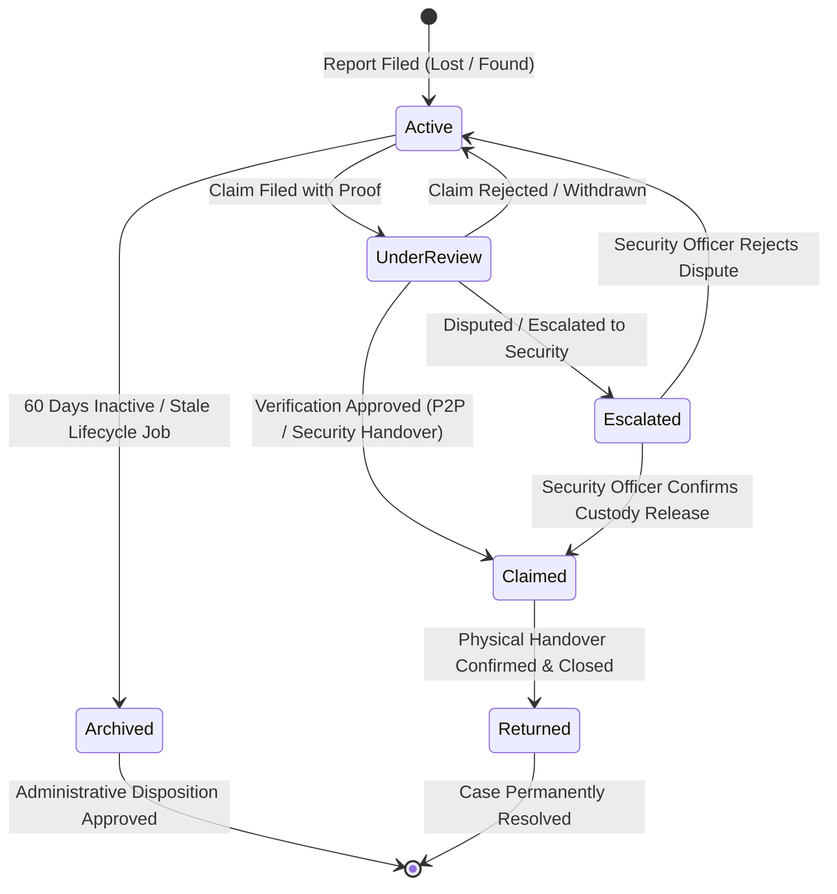
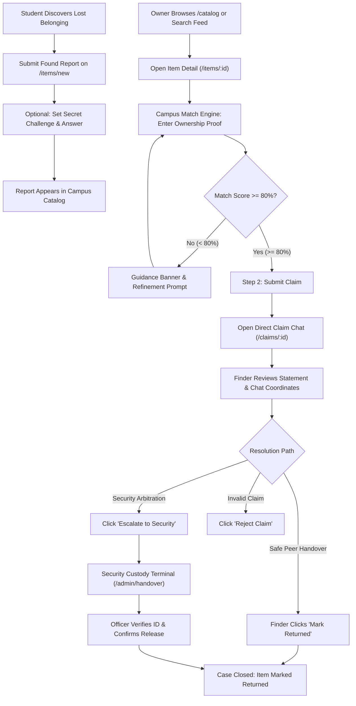
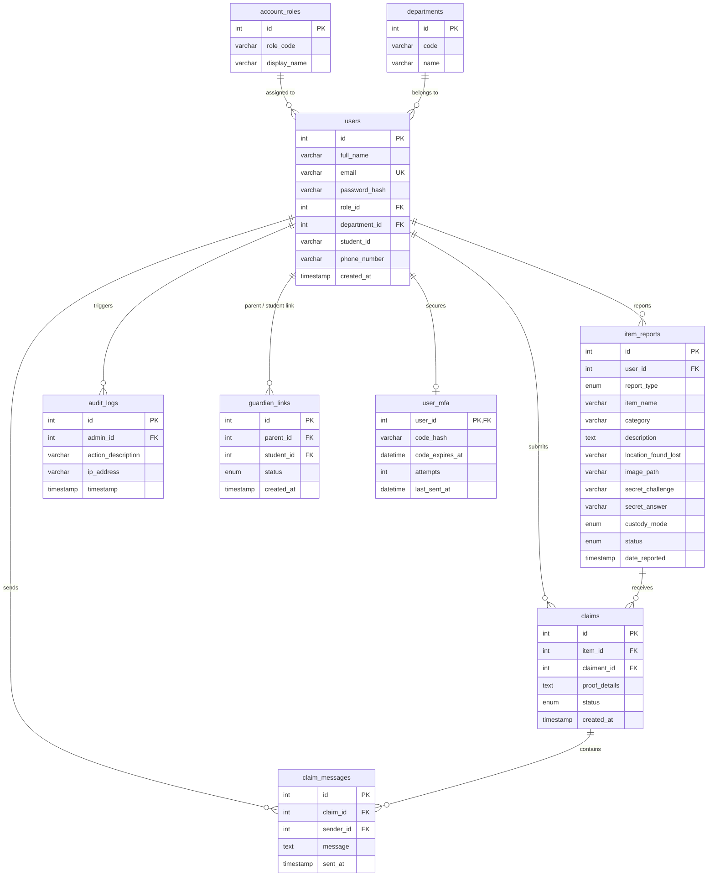

# Project HANAP (*Holistic Asset Notification & Access Portal*)

[](https://nodejs.org/)
[](https://www.mysql.com/)
[](https://tailwindcss.com/)
[](https://my.cspc.edu.ph/)
[](LICENSE)

---

## Table of Contents

1. [Executive Overview](#executive-overview)
2. [Key Capabilities & Innovations](#key-capabilities--innovations)
3. [Technology Stack](#technology-stack)
4. [System Architecture & Lifecycle Workflow](#system-architecture--lifecycle-workflow)
5. [Database Architecture & Data Model](#database-architecture--data-model)
6. [Repository Structure](#repository-structure)
7. [Installation & Setup Guide](#installation--setup-guide)
8. [Configuration & Environment Variables](#configuration--environment-variables)
9. [Pre-Configured Test Accounts](#pre-configured-test-accounts)
10. [Comprehensive Route Directory](#comprehensive-route-directory)
11. [Security, Privacy & Compliance Measures](#security-privacy--compliance-measures)
12. [Academic Course Metadata & Team Attribution](#academic-course-metadata--team-attribution)
13. [License](#license)

---

## Executive Overview

**Project HANAP** (*Holistic Asset Notification & Access Portal*) is an institutional-grade, web-based Campus Lost and Found, Asset Tracking, and Item Recovery System engineered for **Camarines Sur Polytechnic Colleges (CSPC)** in Nabua, Camarines Sur.

Across collegiate campus grounds, hundreds of critical personal and academic assets—such as institutional identification cards, laptops, scientific calculators, laboratory coats, keys, and wallets—are misplaced each semester. Traditional lost-and-found management relies heavily on disconnected physical paper logs, unmonitored drop-off counters, and disorganized social media feeds. This disjointed workflow leads to low recovery rates, lack of privacy, fraudulent claims, and heavy administrative overhead.

Project HANAP solves these challenges with an auditable, role-restricted, responsive portal featuring:
- **Direct Peer-to-Peer (P2P) Coordination** powered by an automated string-distance **Campus Match Engine** and private verification challenges.
- **Centralized Security Desk Custody Handover** workflows for official property releases and physical logging.
- **End-to-End Auditability** with automated 60-day disposition queues, administrative batch actions, and chronological security audit logs.
- **Privacy Protections** including automatic phone number masking, Email Multi-Factor Authentication (MFA), and institutional email domain verification.

---

## Key Capabilities & Innovations

### 1. Smart Campus Match Engine & Verification Stepper
- **Algorithmic Confidence Scoring:** Evaluates claimant ownership proofs against secret challenge answers using normalized Levenshtein edit distance and token matching (`services/answerMatch.js`).
- **Dynamic Radial SVG Progression Gauge:** Displays real-time match confidence ($0\%$ to $100\%$) on the item detail page, advancing claimants through a visual two-step verification workflow.
- **Anti-Fraud Security Constraints:** Requires claimants to meet or exceed an $80\%$ minimum threshold before filing claims on private-challenge items, preventing guessing and social engineering.

### 2. Dual Handover Architecture: P2P Chat vs. Security Custody
- **Direct P2P Chat Thread:** Enables secure communication between finders and claimants with real-time status management (`pending`, `approved`, `escalated`, `returned`, `rejected`).
- **In-Chat Contact Masking:** Automatically redacts raw phone numbers (`09**-***-**09`) to protect student privacy until mutual identity is verified.
- **One-Click Security Escalation:** Allows any party to escalate disputes or high-value items directly to the Campus Security Office for arbitration.
- **Physical Custody Handover Terminal:** Equips security personnel with dedicated terminals (`/admin/handover`) to verify student IDs, review item custody status, and sign off on physical release ledgers.

### 3. Institutional Identity & Account Security
- **Domain-Enforced RBAC:** Restricts institutional registration to verified `@my.cspc.edu.ph` (students) and `@cspc.edu.ph` (faculty and staff) domains, with dedicated Guest and Parent routing.
- **Parent/Guardian Student Linkage:** Allows external parents and guardians to link accounts to verified student profiles subject to student approval in Account Settings.
- **Email Multi-Factor Authentication (MFA):** Supports single-use, 6-digit TOTP verification codes (10-minute expiry, 5-attempt lockout, 60-second cooldown) with real SMTP delivery and a local development console fallback.

### 4. 60-Day Lifecycle Automation & Administrative Governance
- **Automated Stale Item Archiving:** Daily background scheduler (`services/lifecycle.js`) flags and transitions unclaimed active items older than 60 days into the administrative disposition queue.
- **Batch Disposition Approval:** Administrative batch approval (`POST /admin/reports/batch-approve`) and single-report disposition actions with audit tracking.
- **Interactive Analytics Dashboard:** Real-time metrics comparing P2P resolution efficiency vs. centralized office turn-ins, category breakdown distributions, and average turnaround times.
- **Data Export:** Instant CSV ledger downloads of campus reports and disposition registries.

### 5. UI/UX Design System
- **Aurora Glass Aesthetics:** Built with Tailwind CSS, backdrop blurs, frosted glass panels, and smooth micro-interactions.
- **Daylight & Night Mode Themes:** Complete theme toggle between **Light Horizon** and **Serene Horizon Night Mode**, persisted across sessions via `localStorage` and `html.dark`.
- **Adaptive Floating Dock Navigation:** Responsive capsule dock with dynamic active states, unread notification counter badges, and responsive navigation drawers for mobile and tablet screens.

---

## Technology Stack

| Layer | Component | Specification / Version | Purpose |
| :--- | :--- | :--- | :--- |
| **Runtime** | Node.js | `>= 18.0.0` (LTS v20 / v24 tested) | Asynchronous JavaScript server runtime environment |
| **Web Framework** | Express.js | `^5.3.0` | High-performance MVC routing, middleware pipeline, and REST handlers |
| **View Engine** | EJS | `^7.0.2` | Server-rendered templates with dual lookup paths (`views/pages/` and `views/`) |
| **Database** | MySQL | `8.0+` | Relational storage engine with foreign keys, transactions, and UTF8MB4 |
| **Database Driver** | `mysql2` | `^3.24.6` | Connection pooling (`mysql2/promise`) with prepared parameterized queries |
| **Authentication** | `bcrypt` & `express-session` | `bcrypt ^6.0.0` / `session ^1.19.0` | Salted password hashing (cost factor 10) & secure HTTP-only sessions |
| **Security Suite** | `helmet` | `^8.3.0` | HTTP headers with CSP tailored for Tailwind CDN, Google Fonts, and self-hosted assets |
| **File Uploads** | `multer` | `^2.5.0` | Disk storage for item images with mime-type filters and sanitized filenames |
| **Mailing / MFA** | `nodemailer` | `^10.2.1` | SMTP email transport with local development console fallback |
| **Styling & Icons** | Tailwind CSS CDN & Material Symbols | Plus Jakarta Sans, Forms, Container Queries | Glassmorphic design tokens, responsive typography, and iconography |
| **Development** | `nodemon` & `dotenv` | `nodemon ^3.1.14` / `dotenv ^18.0.9` | Hot reloading and multi-environment variable injection |

---

## System Architecture & Lifecycle Workflow

### Item Lifecycle State Machine



### End-to-End User Verification Workflow



---

## Database Architecture & Data Model

The database is built on MariaDB / MySQL using InnoDB with UTF8MB4 character encoding, cascading foreign key constraints, connection pooling, and transactional integrity.



---

## Repository Structure

```ascii
projectHanap/
├── config/
│   ├── db.js                      # MySQL2 connection pool with async connectivity check
│   ├── roles.js                   # Institutional role constants, domain & password validators
│   └── security.js                # Rate limiters & CSRF token injector and protection middleware
├── controllers/
│   ├── authController.js          # Authentication, registration, MFA login challenge & logout
│   ├── homeController.js          # Public landing portal controller
│   └── itemController.js          # Catalog, reporting, matching, claims, chat, settings, admin handlers
├── middleware/
│   ├── auth.js                    # Session gatekeepers (requireAuth, requireAdmin, requireNonAdminAuth)
│   ├── csrf.js                    # CSRF verification middleware
│   ├── reportUpload.js            # Multer diskStorage configuration & reportUploadBeforeCsrf parser
│   └── viewLocals.js              # Injects authenticated user, admin flag & notification counts into res.locals
├── models/
│   ├── auditLogModel.js           # Admin audit trail queries
│   ├── claimModel.js              # P2P claims, messages, handover queues & analytics metrics
│   ├── connectionModel.js         # Connection pooling abstraction
│   ├── guardianLinkModel.js       # Parent/Guardian student relationship verification
│   ├── itemReportModel.js         # Item CRUD, catalog filtering, stats, and disposition queries
│   ├── mfaModel.js                # TOTP verification codes, attempt counters & expiry logic
│   ├── schemaModel.js             # DDL helper queries
│   └── userModel.js               # User authentication, role queries, and profile management
├── public/
│   ├── css/
│   │   └── style.css              # Custom utility styles, scrollbar hiding, and dark mode tokens
│   ├── js/
│   │   └── main.js                # Client-side helpers, timeAgo formatters, and flash dismissers
│   └── uploads/                   # Multer image upload destination directory (auto-created)
├── routes/
│   ├── authRoutes.js              # Authentication endpoints (/login, /register, /logout)
│   ├── homeRoutes.js              # Public root routing (/)
│   └── itemRoutes.js              # Catalog, reports, claims, chat, settings & admin routing
├── services/
│   ├── answerMatch.js             # String distance normalization & answer confidence scoring
│   ├── email.js                   # Nodemailer SMTP transporter with dev console fallback
│   ├── lifecycle.js               # 60-day automated stale report background cleaner
│   └── mfa.js                     # 6-digit TOTP code generation & bcrypt hash verification
├── views/
│   ├── pages/
│   │   ├── 403.ejs                # Access denied & forbidden error display
│   │   ├── adminAnalytics.ejs     # P2P vs. Centralized Handover statistical performance metrics
│   │   ├── adminAuditLogs.ejs     # Chronological administrative security audit log
│   │   ├── adminDashboard.ejs     # Administrator central hub & turnover overview
│   │   ├── adminReports.ejs       # 60-day disposition queue, report matrix & CSV export
│   │   ├── adminUsers.ejs         # User directory, role switcher & quota reset terminal
│   │   ├── chat.ejs               # Real-time peer claim coordination chat with contact masking
│   │   ├── claims.ejs             # Claims hub (made and received claims)
│   │   ├── custodyHandover.ejs    # Security Desk physical property release terminal
│   │   ├── dashboard.ejs          # Student/Staff personal dashboard & catalog browser
│   │   ├── editReport.ejs         # Report edit form with category selection
│   │   ├── guestClaim.ejs         # Security routing guidance for parents and guests
│   │   ├── landing.ejs            # High-conversion public homepage & portal gateway
│   │   ├── login.ejs              # Dual-tab login (Institution vs. Guest) with MFA challenge
│   │   ├── myReports.ejs          # User's submitted reports management matrix
│   │   ├── postDetail.ejs         # Item showcase, Campus Match Engine & verification stepper
│   │   ├── register.ejs           # Dual-tab registration with password strength meter
│   │   ├── reportItem.ejs         # Multi-step item submission form with photo upload
│   │   ├── settings.ejs           # Account settings studio (Profile, Security, MFA, Posts, Logs)
│   │   └── partials/              # Forwarding partials for template compatibility
│   └── partials/
│       ├── navbar.ejs             # Floating glass capsule navigation dock & mobile menu
│       └── themeSetup.ejs         # Early dark-mode script preventing theme flash
├── .env.example                   # Environment configuration template
├── .gitignore                     # Git ignore rules for node_modules, .env, and uploads
├── app.js                         # Core Express server entrypoint, middleware chain & scheduler
├── package.json                   # Project metadata, dependencies, and NPM scripts
├── project_hanap (4).sql          # Authoritative MariaDB/MySQL database schema and seed data
└── README.md                      # Comprehensive system documentation
```

---

## Installation & Setup Guide

### Prerequisites
- **Node.js:** Version `18.x`, `20.x`, or `24.x` LTS ([Download Node.js](https://nodejs.org/))
- **MariaDB / MySQL:** Version `10.4+` / `8.0+` (via XAMPP, MySQL Workbench, Docker, or native service)
- **Git:** Version `2.x+` ([Download Git](https://git-scm.com/))

### Step 1: Clone the Repository
```bash
git clone https://github.com/veirubyte/projecthanap_ptappdev.git
cd projecthanap_ptappdev
```

### Step 2: Install Dependencies
```bash
npm install
```

### Step 3: Configure Local Environment
Create your local `.env` configuration file from the template:

```bash
# Windows (PowerShell):
Copy-Item .env.example .env

# macOS / Linux:
cp .env.example .env
```

Review and adjust `.env` parameters to match your local MySQL configuration:
```env
PORT=3000
DB_HOST=127.0.0.1
DB_PORT=3306
DB_USER=root
DB_PASS=
DB_NAME=project_hanap
SESSION_SECRET=project_hanap_super_secure_session_key_2026
NODE_ENV=development
```

### Step 4: Import the Database Schema
1. Start your MySQL/MariaDB server (e.g. start MySQL in the XAMPP Control Panel).
2. Open a terminal or MySQL CLI and import `project_hanap (4).sql`:

```bash
# Using MySQL CLI:
mysql -u root -p -e "CREATE DATABASE IF NOT EXISTS project_hanap CHARACTER SET utf8mb4 COLLATE utf8mb4_unicode_ci;"
mysql -u root -p project_hanap < "project_hanap (4).sql"
```

> [!NOTE]
> `project_hanap (4).sql` automatically creates all required tables (`account_roles`, `departments`, `users`, `user_mfa`, `guardian_links`, `item_reports`, `claims`, `claim_messages`, `audit_logs`) and populates seed departments, roles, test accounts, active item reports with secret challenges, and initial claims.

### Step 5: Start the Application Server

- **Development Mode (Auto-Reloading via Nodemon):**
  ```bash
  npm run dev
  ```

- **Production Mode:**
  ```bash
  npm start
  ```

Once started, open your browser and navigate to:
**`http://localhost:3000`**

---

## Configuration & Environment Variables

| Variable Name | Required | Default Value | Description |
| :--- | :---: | :--- | :--- |
| `PORT` | No | `3000` | Port on which the Express HTTP server listens |
| `DB_HOST` | Yes | `127.0.0.1` | MySQL/MariaDB database server hostname or IP |
| `DB_PORT` | No | `3306` | MySQL server port |
| `DB_USER` | Yes | `root` | Database authentication username |
| `DB_PASS` / `DB_PASSWORD` | No | `""` (empty) | Database authentication password |
| `DB_NAME` | Yes | `project_hanap` | Database schema name |
| `SESSION_SECRET` | Yes | `project_hanap_secret...` | Secret key used to sign session cookies with `express-session` |
| `NODE_ENV` | No | `development` | Environment mode (`development` enables dev logging & HTTP-safe cookies; `production` enforces HTTPS cookies and secure CSP) |
| `SMTP_HOST` | Optional | `undefined` | SMTP server host (e.g. `smtp.gmail.com`). If omitted in dev, MFA codes log to terminal |
| `SMTP_PORT` | Optional | `587` | SMTP port (`587` for STARTTLS, `465` for SSL) |
| `SMTP_USER` | Optional | `undefined` | SMTP authentication username / email |
| `SMTP_PASSWORD` | Optional | `undefined` | SMTP application password |
| `SMTP_FROM` | Optional | `no-reply@cspc.edu.ph` | Outgoing email sender address |
| `SMTP_FROM_NAME` | Optional | `Project HANAP` | Outgoing email sender name |

> [!TIP]
> In local development (`NODE_ENV=development`), if no SMTP credentials are configured, `services/email.js` automatically activates a **console fallback**. Verification codes and security notices are logged directly to your terminal (e.g., `[HANAP Email Fallback] MFA verification code for student@my.cspc.edu.ph: 123456`), allowing complete testing of the MFA flow without an external mail provider.

---

## Pre-Configured Test Accounts

The seed database (`project_hanap (4).sql`) includes pre-configured, bcrypt-hashed test accounts representing every role:

| Role Code | Role Name | Email Address | Password | Sample Data & Purpose |
| :--- | :--- | :--- | :--- | :--- |
| **`admin`** | System Administrator | `admin@cspc.edu.ph` | `password123` | Full access to `/admin/*`, Custody Handover, 60-day Archive Disposition, User Directory, Analytics, and Audit Logs. |
| **`student`** | Student (CCS) | `maria@my.cspc.edu.ph` | `password123` | Reporter of Lost Calculator (`fx-991EX`), Claimant on Item #1 (`Blue CSPC Lanyard`), Active P2P claim chat. |
| **`student`** | Student (CCS) | `juan@my.cspc.edu.ph` | `password123` | Reporter of Found Item #1 (`Blue CSPC Lanyard`) and Item #4 (`Silver Water Bottle`) with active secret challenge questions. |
| **`student`** | Student | `marta@my.cspc.edu.ph` | `password123` | Reporter of Item #5 with photo upload, eligible to file live claims on Item #1 and Item #4. |
| **`parent` / `guest`**| Parent / Campus Guest | `parent@gmail.com` | `password123` | Guest portal browsing, student guardian linkage requests, and Security Desk handover routing. |

---

## Comprehensive Route Directory

### 1. Public & Core Authentication Routes
| Method | Route | Controller Handler | Access Scope | Description |
| :---: | :--- | :--- | :---: | :--- |
| `GET` | `/` | `homeController.showLanding` | Public | Public landing homepage with feature spotlights and CTA |
| `GET` | `/login` | `authController.showLogin` | Public (Guest) | Dual-tab sign-in page with MFA challenge support |
| `POST` | `/login` | `authController.login` | Public (Guest) | Processes credentials, evaluates role, triggers MFA or redirects |
| `GET` | `/register` | `authController.showRegistration` | Public (Guest) | Registration page with password complexity validation |
| `POST` | `/register` | `authController.register` | Public (Guest) | Creates account with institutional domain verification |
| `GET` | `/logout` | `authController.logout` | Authenticated | Destroys session, clears cookies, redirects to `/login` |

### 2. Catalog & Item Reporting Routes
| Method | Route | Controller Handler | Access Scope | Description |
| :---: | :--- | :--- | :---: | :--- |
| `GET` | `/catalog` | `itemController.showDashboard` | Public | Searchable campus catalog with filters (type, category, period, status) |
| `GET` | `/dashboard` | `itemController.showDashboard` | Authenticated | Student/Staff dashboard with 4-step progress trackers and live claim widgets |
| `GET` | `/items/new` | `itemController.showNewReportForm` | Authenticated | Multi-step form to report a lost or found item |
| `POST` | `/items/report` | `itemController.createItemReport` | Authenticated | Processes new report with Multer photo upload |
| `GET` | `/items/:id` | `itemController.showItemDetails` | Public | Item detail page with Campus Match Engine and verification stepper |
| `POST` | `/items/:id/match-preview` | `itemController.previewOwnershipMatch` | Authenticated | AJAX endpoint calculating live answer match score percentage |
| `POST` | `/items/:id/claim` | `itemController.createClaim` | Authenticated | Validates match threshold and files ownership claim |
| `GET` | `/claims/guest-claim` | `itemController.showGuestClaimGuide` | Public | Routing guide for parents and guests to the Security Desk |

### 3. Claims Coordination, P2P Chat & Reports Management
| Method | Route | Controller Handler | Access Scope | Description |
| :---: | :--- | :--- | :---: | :--- |
| `GET` | `/claims` | `itemController.listClaims` | Authenticated | Claims hub displaying made and received ownership claims |
| `GET` | `/claims/:id` | `itemController.showClaimChat` | Participant / Admin | P2P coordination chat with masked contact details |
| `POST` | `/claims/:id/messages` | `itemController.sendClaimMessage` | Participant / Admin | Sends message inside active claim thread |
| `POST` | `/claims/:id/status` | `itemController.updateClaimStatus` | Reporter / Admin | Updates claim state (`approved`, `rejected`, `escalated`, `returned`) |
| `POST` | `/claims/:id/cancel` | `itemController.cancelClaim` | Claimant | Withdraws an active pending claim |
| `GET` | `/my-reports` | `itemController.listMyReports` | Authenticated | Management matrix for all personal reported items |
| `POST` | `/items/:id/status` | `itemController.updateItemStatus` | Owner / Admin | Updates item status (e.g. marks item as `returned`) |
| `POST` | `/items/:id/delete` | `itemController.deleteItemReport` | Owner / Admin | Deletes item report from database |
| `GET` | `/items/:id/edit` | `itemController.showEditItemForm` | Owner / Admin | Renders report edit form with category selection |
| `POST` | `/items/:id/edit` | `itemController.updateItemReport` | Owner / Admin | Updates report details, locations, and verification challenge |

### 4. Account Settings Studio
| Method | Route | Controller Handler | Access Scope | Description |
| :---: | :--- | :--- | :---: | :--- |
| `GET` | `/settings` | `itemController.showSettings` | Authenticated | Tabbed settings studio (Profile, Security, MFA, Posts, Logs) |
| `POST` | `/settings/profile` | `itemController.updateProfile` | Non-Admin | Updates display name and phone number |
| `POST` | `/settings/security` | `itemController.updateSecurity` | Authenticated | Updates account password with strength validation |
| `POST` | `/settings/mfa/enable` | `itemController.enableMfa` | Authenticated | Activates Email MFA with password re-authentication |
| `POST` | `/settings/mfa/disable` | `itemController.disableMfa` | Authenticated | Deactivates Email MFA with password re-authentication |
| `POST` | `/settings/notifications` | `itemController.updateNotificationSettings`| Authenticated | Saves email notification preferences |
| `POST` | `/settings/guardian-links` | `itemController.createGuardianLink` | Parent / Guest | Submits linkage request to a student account |
| `POST` | `/settings/guardian-links/:id/:decision` | `itemController.decideGuardianLink` | Student | Approves or rejects incoming parent linkage request |
| `POST` | `/settings/delete-account` | `itemController.deleteAccount` | Non-Admin | Permanently deletes account with confirmation |

### 5. Administrative Platform Governance
| Method | Route | Controller Handler | Access Scope | Description |
| :---: | :--- | :--- | :---: | :--- |
| `GET` | `/admin/dashboard` | `itemController.showAdminDashboard` | Administrator | Central administrative command center & metrics |
| `GET` | `/admin/handover` | `itemController.listHandoverClaims` | Administrator | Custody Handover Terminal queue for campus security |
| `GET` | `/admin/handover/:claimId` | `itemController.showHandoverClaim` | Administrator | Single physical handover item verification terminal |
| `POST` | `/admin/handover/:claimId/confirm`| `itemController.confirmHandover` | Administrator | Confirms physical custody release and closes claim |
| `POST` | `/admin/handover/:claimId/reject` | `itemController.rejectHandover` | Administrator | Rejects physical custody release for security reasons |
| `GET` | `/admin/users` | `itemController.listAdminUsers` | Administrator | User directory with department tracking & role management |
| `POST` | `/admin/users/add` | `itemController.createAdminUser` | Administrator | Enrolls new institutional account directly |
| `POST` | `/admin/users/:id/role` | `itemController.updateUserRole` | Administrator | Promotes or reassigns user role |
| `POST` | `/admin/users/:id/quota-reset` | `itemController.resetUserQuota` | Administrator | Resets user submission quota limits |
| `GET` | `/admin/reports` | `itemController.listAdminReports` | Administrator | 60-day disposition queue, report matrix & CSV export |
| `POST` | `/admin/reports/:id/archive-approve`| `itemController.approveReportArchive` | Administrator | Approves single item for permanent disposition |
| `POST` | `/admin/reports/batch-approve` | `itemController.batchApproveReportArchive` | Administrator | Batch-approves all overdue 60-day disposition items |
| `GET` | `/admin/analytics` | `itemController.showAdminAnalytics` | Administrator | P2P vs Centralized Handover statistical performance overview |
| `GET` | `/admin/audit-logs` | `itemController.listAuditLogs` | Administrator | Chronological administrative security audit log |
| `POST` | `/admin/items/log` | `itemController.createAdminItemReport`| Administrator | Logs office turn-in directly with photo upload |

---

## Security, Privacy & Compliance Measures

1. **SQL Injection Defense:** All database queries utilize parameterized prepared statements via `mysql2/promise`. User inputs are never concatenated directly into SQL query strings.
2. **Cross-Site Request Forgery (CSRF):** Custom session-backed CSRF tokens are injected on every session and verified across all modifying HTTP methods (`POST`, `PUT`, `DELETE`). AJAX calls pass tokens via `CSRF-Token` / `x-csrf-token` headers.
3. **Content Security Policy (CSP):** Configured through `helmet` to restrict script execution, block unauthorized frame injection, allow verified CDN stylesheets and fonts, and enforce secure communication while supporting local HTTP development.
4. **Brute-Force & Rate Limiting:** Sliding-window in-memory rate limiting applied to `/login` (20 attempts / 15 minutes) and `/register` (10 attempts / 60 minutes) to prevent brute-force credential stuffing.
5. **Password Security:** Cryptographically secure password hashing using `bcrypt` (10 salt rounds) paired with strict server-side complexity validation (minimum 8 characters, uppercase, lowercase, numeric digit, and special character).
6. **In-Chat Privacy Protection:** Automated phone number masking replaces personal contact numbers (`09**-***-**09`) in active peer chats to protect students against harassment.
7. **Institutional Email Whitelisting:** Rigid regular expressions enforce official CSPC domains (`@my.cspc.edu.ph`, `@cspc.edu.ph`) for institutional accounts, directing parents and campus guests into segregated workflows.
8. **Security Audit Logging:** All administrative actions—such as role modifications, physical custody releases, report deletions, and 60-day disposition approvals—are immutably logged with the acting administrator's ID, description, client IP address, and timestamp.

---

## Academic Course Metadata & Team Attribution

- **Course Title:** Platform Technologies & Web Application Development (`PTAppDev`)
- **Institution:** Camarines Sur Polytechnic Colleges (CSPC) &bull; College of Computer Studies
- **Academic Term / Year:** Academic Year 2025–2026
- **System Scope:** Campus Lost and Found, Asset Tracking & Property Recovery Portal
- **Repository Remote:** `https://github.com/veirubyte/projecthanap_ptappdev.git`

---

## License

This project is licensed under the terms of the **MIT License**. For complete terms, permissions, and conditions, refer to the [LICENSE](LICENSE) file located in the root repository directory.
