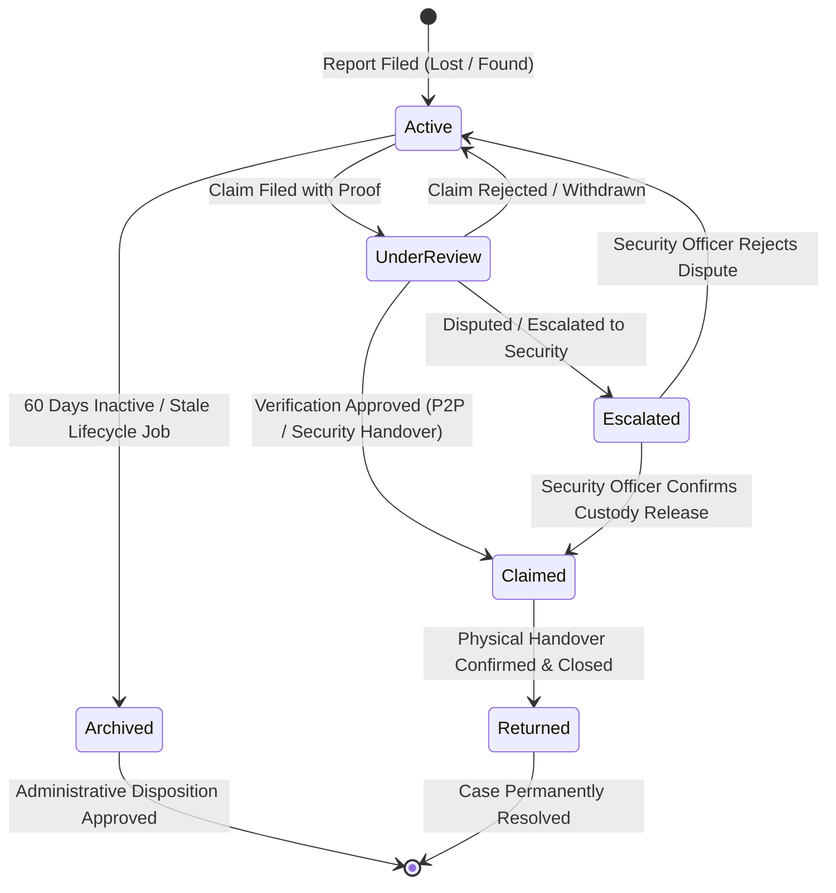
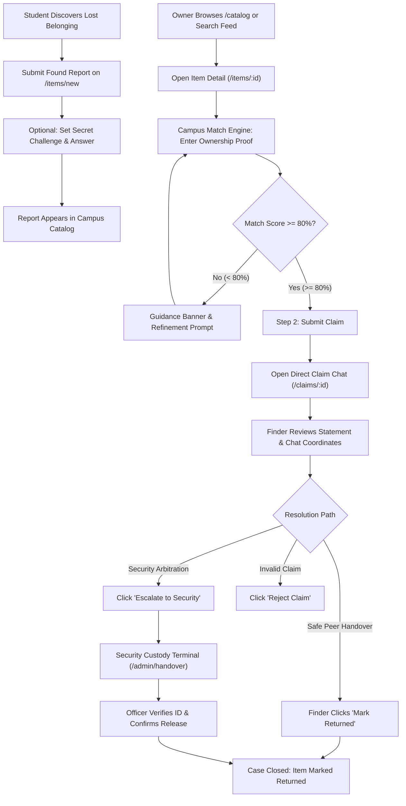
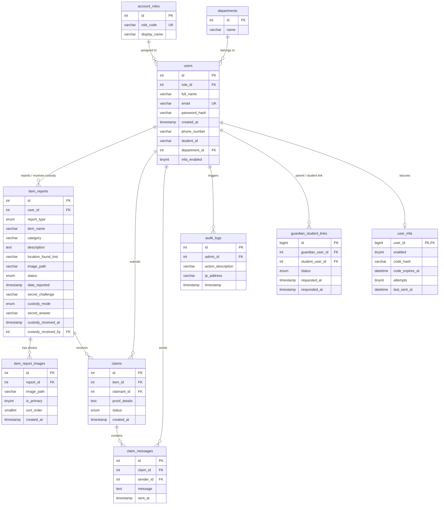

# Project HANAP (*Holistic Asset Notification & Access Portal*)

[](https://nodejs.org/)
[](https://www.mysql.com/)
[](https://tailwindcss.com/)
[](https://ai.google.dev/)
[](https://my.cspc.edu.ph/)
[](LICENSE)

---

## Table of Contents

1. [Project Description](#1-project-description)
2. [Team Members](#2-team-members)
3. [Assigned System](#3-assigned-system)
4. [Features](#4-features)
5. [Technologies](#5-technologies)
6. [Installation](#6-installation)
7. [Configuration](#7-configuration)
8. [Database Setup](#8-database-setup)
9. [How to Run](#9-how-to-run)
10. [User Accounts](#10-user-accounts)
11. [Project Structure](#11-project-structure)
12. [Known Limitations](#12-known-limitations)
13. [AI Assistance Disclosure](#13-ai-assistance-disclosure)
14. [License](#14-license)

---

## 1. Project Description

**Project HANAP** (*Holistic Asset Notification & Access Portal*) is an institutional-grade, web-based **Campus Lost and Found, Asset Tracking, and Item Recovery System** engineered for **Camarines Sur Polytechnic Colleges (CSPC)** in Nabua, Camarines Sur.

### Problem Being Addressed
Across collegiate campus grounds, hundreds of critical personal and academic assets, such as institutional identification cards, laptops, scientific calculators, laboratory coats, keys, and wallets are misplaced each semester. Traditional lost-and-found management relies heavily on disconnected physical paper logs, unmonitored drop-off counters, and disorganized social media feeds. This disjointed workflow leads to low recovery rates, lack of privacy, fraudulent claims, and heavy administrative overhead.

### Main Purpose
Project HANAP replaces fragmented manual tracking with an auditable, role-restricted, responsive web portal featuring:
- **Direct Peer-to-Peer (P2P) Coordination** powered by an automated string-distance **Campus Match Engine** and private verification challenges.
- **Centralized Security Desk Custody Handover** workflows for official property intake receipts, physical logging, and verified releases.
- **End-to-End Auditability** with automated 60-day disposition queues, administrative batch actions, and chronological security audit logs.
- **Privacy & Account Protections** including automatic phone number masking in chat, Email Multi-Factor Authentication (MFA), and institutional email domain verification.
- **Embedded AI Guidance** via the **HANAP AI Assistant** widget to help campus users navigate reporting, claiming, and handover protocols.

### Target Users
- **Students (`@my.cspc.edu.ph`):** Report misplaced personal belongings, log found campus items, submit ownership claims, and coordinate peer or security handovers.
- **Faculty & Staff (`@cspc.edu.ph`):** Report and inspect surrendered items across academic buildings, laboratories, and libraries.
- **Parents & Campus Guests:** Browse public catalog listings, link accounts to verified student profiles, and follow guided Security Desk claim protocols.
- **System Administrators & Campus Security Personnel:** Manage physical item custody intake/release ledgers, arbitrate escalated claims, oversee the 60-day archive disposition queue, manage users/roles, and audit system logs.

---

## 2. Team Members

Project HANAP was collaboratively designed, engineered, tested, and documented by the following development team:

| Team Member | Assigned Roles | Primary Responsibilities & Contributions |
| :--- | :--- | :--- |
| **Janel Laynes** | **Lead Full-Stack Developer**<br>**Lead Deliverables Manager** | Core full-stack architecture, Express MVC integration, database schema & query models, authentication/MFA & AI assistant integration, pull request verification, and milestone deliverables management. |
| **Jake Roi Eloreta** | **Project Manager**<br>**Assistant Full-Stack Developer**<br>**GitHub Manager**<br>**UI/UX Developer** | Project planning & task coordination, GitHub repository/branch/PR workflow governance, Campus Match Engine & verification stepper implementation, and UI/UX design system refinement. |
| **John Paul Rendon** | **Lead Backend Developer**<br>**Assistant Deliverables Manager** | Backend route handlers, business logic controllers, server-side input validation, security/access-control middleware, database persistence operations, and technical deliverables review. |
| **Mherly Simbulan** | **Lead Frontend Developer**<br>**Assistant Secretary** | EJS view templates, responsive Tailwind CSS layouts, interactive forms, client-side scripts, dark/light theme support, and project documentation/requirements recording. |

### GitHub Collaboration & Development Workflow

In accordance with the PTAppDev Midterm Project guidelines, our team followed a disciplined GitHub workflow:
- **Feature Branching:** Development was conducted on dedicated feature branches (e.g., `feature/match-engine`, `feature/HANAP-AI-Assistant`, `feature/custody-handover`, `feature/auth-mfa`) rather than committing directly to `main`.
- **Pull Requests & Peer Code Reviews:** Major features were submitted via Pull Requests using `.github/pull_request_template.md` and reviewed by teammates for functionality, validation, security, and code clarity prior to merging.
- **Conventional Commits:** Commit history adheres to Conventional Commit prefixes (`feat:`, `fix:`, `docs:`, `refactor:`, `chore:`).
- **Issue & Project Board Tracking:** Tasks were organized using GitHub Issues (`.github/ISSUE_TEMPLATE/task_issue.md`) and tracked across our GitHub Project Board (`BACKLOG` $\rightarrow$ `TODO` $\rightarrow$ `IN PROGRESS` $\rightarrow$ `REVIEW` $\rightarrow$ `DONE`).

---

## 3. Assigned System

| Metadata Field | Specification |
| :--- | :--- |
| **Assigned Campus System** | **Campus Lost and Found & Item Tracking System (Round 1)** |
| **System Title** | **Project HANAP** (*Holistic Asset Notification & Access Portal*) |
| **Course** | Platform Technologies & Web Application Development (`PTAppDev`) |
| **Target Institution** | Camarines Sur Polytechnic Colleges (CSPC) &bull; College of Computer Studies |
| **Academic Year** | A.Y. 2025–2026 (Midterm Project – Round 1) |
| **System Requirements Spec** | See [`docs/REQUIREMENTS.md`](docs/REQUIREMENTS.md) for full SRS, Stakeholders, FRs, NFRs, and Use Cases |

### System Requirements & Use Cases Summary

The full System Requirements Specification is maintained in [`docs/REQUIREMENTS.md`](docs/REQUIREMENTS.md). Below is an executive summary:

- **Stakeholders:** CSPC Student Body, Campus Security & Public Safety Office, Office of Student Affairs (OSA), University Library & Laboratory Custodians, and MIS/IT Infrastructure Team.
- **Core Functional Requirements (`FR-01` – `FR-10`):** Institutional & guest registration, session-based login/logout with optional Email MFA, strict Role-Based Access Control (`requireAuth`, `requireNonAdminAuth`, `requireAdmin`), server-side form validation, lost/found report creation with photo uploads, physical custody intake logging, Campus Match Engine claim verification, multi-filter catalog search, and normalized MySQL persistence.
- **Core Non-Functional Requirements (`NFR-01` – `NFR-05`):** `bcrypt` password hashing (10 salt rounds), `.env` secret isolation, low-latency parameterized MySQL queries, ACID transactional durability across restarts, and mobile-first responsive UI.

---

## 4. Features

### 1. Smart Campus Match Engine & Verification Stepper
- **Algorithmic Confidence Scoring:** Evaluates claimant ownership proofs against secret challenge answers using Unicode NFKC normalization, token-based Jaccard overlap, and space-optimized Levenshtein edit distance (`services/answerMatch.js`).
- **Dynamic Radial SVG Progression Gauge:** Displays real-time match confidence ($0\%$ to $100\%$) on the item detail page via `POST /items/:id/match-preview`, advancing claimants through a visual two-step verification workflow.
- **Anti-Fraud Security Constraints:** Requires claimants to meet or exceed an **$80\%$ minimum threshold** before filing claims on private-challenge items, preventing guessing and social engineering.

### 2. Dual Handover Architecture: P2P Chat vs. Security Custody
- **Direct P2P Chat Thread:** Enables secure communication between finders and claimants with real-time status management (`pending`, `approved`, `escalated`, `returned`, `rejected`).
- **In-Chat Contact Masking:** Automatically redacts raw phone numbers (`09**-***-**09`) to protect student privacy until mutual identity is verified.
- **One-Click Security Escalation:** Allows any party to escalate disputes or high-value items directly to the Campus Security Office for arbitration.
- **Physical Custody Intake & Handover Terminal:** Equips security personnel with dedicated terminals (`/admin/handover` and `/admin/items/:id/accept-custody`) to log physical item receipt (`custody_received_at`, `custody_received_by`), verify student IDs, and sign off on physical release ledgers.

### 3. Institutional Identity & Account Security
- **Domain-Enforced RBAC:** Restricts institutional registration to verified `@my.cspc.edu.ph` (students) and `@cspc.edu.ph` (faculty and staff) domains, with dedicated Guest and Parent routing.
- **Parent/Guardian Student Linkage:** Allows external parents and guardians to link accounts to verified student profiles subject to student approval in Account Settings (`guardian_student_links`).
- **Email Multi-Factor Authentication (MFA):** Supports single-use, 6-digit TOTP verification codes (10-minute expiry, 5-attempt lockout, 60-second cooldown) with real SMTP delivery and a local development console fallback.

### 4. 60-Day Lifecycle Automation & Administrative Governance
- **Automated Stale Item Archiving:** Daily background scheduler (`services/lifecycle.js`) flags and transitions unclaimed active items older than 60 days into the administrative disposition queue.
- **Batch Disposition Approval:** Administrative batch approval (`POST /admin/reports/batch-approve`) and single-report disposition actions with audit tracking.
- **Interactive Analytics Dashboard:** Real-time metrics comparing P2P resolution efficiency vs. centralized office turn-ins, category breakdown distributions, and average turnaround times.
- **Multi-Photo Upload & Gallery Support:** Supports primary and multiple item report images (`item_report_images` table) with MIME-type validation and sanitized storage.
- **Data Export:** Instant CSV ledger downloads of campus reports and disposition registries.

### 5. Embedded HANAP AI Assistant
- **Contextual Support Widget:** Floating AI assistant launcher (`views/partials/assistantWidget.ejs`) available to authenticated users across the portal.
- **Google Gemini Integration:** Powered by `@google/genai` (`gemini-3.8-flash`) with strict system instructions (`services/geminiAssistant.js`), rate limiting, and privacy guardrails that prevent disclosure of private database records.

### 6. UI/UX Design System
- **Aurora Glass Aesthetics:** Built with Tailwind CSS, backdrop blurs, frosted glass panels, and smooth micro-interactions.
- **Daylight & Night Mode Themes:** Complete theme toggle between **Light Horizon** and **Serene Horizon Night Mode**, persisted across sessions via `localStorage` and `html.dark`.
- **Adaptive Floating Dock Navigation:** Responsive capsule dock with dynamic active states, unread notification counter badges, and responsive navigation drawers for mobile and tablet screens.

### System Architecture & Lifecycle Workflow

#### Item Lifecycle State Machine



#### End-to-End User Verification Workflow



### Security, Input Validation & Access Control

1. **Role-Based Access Control (`middleware/auth.js`):** Every protected route verifies `req.session.user`. Unauthorized guests are redirected to `/login`, while non-admin users attempting to access `/admin/*` routes are immediately blocked, prevented from bypassing restrictions via direct URL entry, and presented with a 403 Access Denied response.
2. **Comprehensive Server-Side Input Validation:** All user inputs (registration credentials, institutional email domains, password strength segments, item report fields, claim proofs, and chat messages) are validated on the server before database execution, returning descriptive error feedback on invalid or duplicate submissions.
3. **SQL Injection Prevention:** All database operations use parameterized prepared statements via `mysql2/promise`.
4. **CSRF Protection (`config/security.js`):** Per-session cryptographic CSRF tokens are verified on state-changing requests (`POST`, `PUT`, `DELETE`) via form fields (`_csrf`) or AJAX headers (`x-csrf-token`).
5. **HTTP Security Headers & Rate Limiting:** Configured via `helmet` alongside sliding-window rate limiters on `/login` (20 req / 15 min), `/register` (10 req / 60 min), and `/api/assistant/chat` (12 req / 5 min).
6. **In-Chat Privacy & Audit Trail:** Phone numbers shared in peer claim chats are automatically masked (`09**-***-**09`), and all administrative actions are recorded in `audit_logs` with administrator ID, IP address, and timestamp.

---

## 5. Technologies

| Layer | Component | Specification / Version | Purpose |
| :--- | :--- | :--- | :--- |
| **Runtime** | Node.js | `>= 18.0.0` (LTS v20 / v24 tested) | Asynchronous JavaScript server runtime environment |
| **Web Framework** | Express.js | `^5.3.0` | MVC routing, middleware pipeline, and HTTP request handlers |
| **View Engine** | EJS | `^7.0.2` | Server-rendered templates with dual lookup paths (`views/pages/` and `views/`) |
| **Database** | MySQL | `MySQL 8.0+` | Relational storage engine with foreign keys, transactions, and UTF8MB4 |
| **Database Driver** | `mysql2` | `^3.24.6` | Connection pooling (`mysql2/promise`) with prepared parameterized queries |
| **Authentication** | `bcrypt` & `express-session` | `bcrypt ^6.0.0` / `session ^1.19.0` | Salted password hashing (10 salt rounds) & secure HTTP-only sessions |
| **Security Suite** | `helmet` | `^8.3.0` | HTTP headers with CSP tailored for Tailwind CDN, Google Fonts, and self-hosted assets |
| **AI SDK** | `@google/genai` | `^2.31.0` | Official Google GenAI SDK powering the HANAP AI Assistant (`gemini-3.8-flash`) |
| **File Uploads** | `multer` | `^2.5.0` | Disk storage for item images with MIME-type filters and sanitized filenames |
| **Mailing / MFA** | `nodemailer` | `^10.2.1` | SMTP email transport with local development console fallback |
| **Styling & Icons** | Tailwind CSS CDN & Material Symbols | Plus Jakarta Sans, Forms, Container Queries | Glassmorphic design tokens, responsive typography, and iconography |
| **Development** | `nodemon` & `dotenv` | `nodemon ^3.1.14` / `dotenv ^18.0.9` | Hot reloading and environment variable isolation |
| **Version Control** | Git & GitHub | Git `2.x+` / GitHub Flow | Feature branching, pull requests, peer code reviews, and issue tracking |

---

## 6. Installation

### Prerequisites
- **Node.js:** Version `18.x`, `20.x`, or `24.x` LTS ([Download Node.js](https://nodejs.org/))
- **MySQL:** Version `8.0+` (via XAMPP, MySQL Workbench, Laragon, or native service)
- **Git:** Version `2.x+` ([Download Git](https://git-scm.com/))

### Installation Steps

1. Clone the repository:
   ```bash
   git clone https://github.com/veirubyte/projecthanap_ptappdev.git
   cd projecthanap_ptappdev
   ```

2. Install the required Node.js package dependencies:
   ```bash
   npm install
   ```

---

## 7. Configuration

Create your local `.env` configuration file by copying `.env.example`:

```powershell
# Windows (PowerShell):
Copy-Item .env.example .env
```
```bash
# macOS / Linux / Git Bash:
cp .env.example .env
```

Update `.env` with your local database credentials and optional API keys:
```env
PORT=3000
DB_HOST=127.0.0.1
DB_PORT=3306
DB_USER=root
DB_PASS=
DB_PASSWORD=
DB_NAME=project_hanap
SESSION_SECRET=replace_with_a_strong_session_secret_key
GEMINI_API_KEY=
GEMINI_MODEL=gemini-3.8-flash
NODE_ENV=development
```

### Environment Variables Reference

| Variable Name | Required | Default Value | Description |
| :--- | :---: | :--- | :--- |
| `PORT` | No | `3000` | TCP port on which the Express HTTP server listens |
| `DB_HOST` | Yes | `127.0.0.1` | MySQL database server hostname or IP |
| `DB_PORT` | No | `3306` | MySQL server port |
| `DB_USER` | Yes | `root` | Database authentication username |
| `DB_PASS` / `DB_PASSWORD` | No | `""` (empty) | Database authentication password |
| `DB_NAME` | Yes | `project_hanap` | Target database schema name |
| `SESSION_SECRET` | Yes | `project_hanap_secret...` | Cryptographic secret used to sign `express-session` cookies |
| `GEMINI_API_KEY` | Optional | `""` | Server-side Google Gemini API key for the HANAP AI Assistant |
| `GEMINI_MODEL` | Optional | `gemini-3.8-flash` | Gemini model identifier used by `services/geminiAssistant.js` |
| `NODE_ENV` | No | `development` | Execution mode (`development` or `production`) |
| `SMTP_HOST` | Optional | `undefined` | Outgoing SMTP host (if omitted in dev, MFA codes log to console) |
| `SMTP_PORT` | Optional | `587` | Outgoing SMTP port (`587` STARTTLS / `465` SSL) |
| `SMTP_USER` | Optional | `undefined` | SMTP authentication username |
| `SMTP_PASSWORD` | Optional | `undefined` | SMTP authentication password |
| `SMTP_FROM` | Optional | `no-reply@cspc.edu.ph` | Sender email address for MFA notices |
| `SMTP_FROM_NAME` | Optional | `Project HANAP` | Sender display name for outgoing emails |

> [!TIP]
> **Local Development MFA Fallback:** When `NODE_ENV=development` and SMTP variables are omitted, `services/email.js` automatically prints 6-digit MFA verification codes directly to the server terminal (e.g., `[HANAP Email Fallback] MFA verification code for user@my.cspc.edu.ph: 123456`).

---

## 8. Database Setup

1. Start your **MySQL** service (e.g., click **Start** next to MySQL in the XAMPP Control Panel).
2. Create the `project_hanap` database and import `project_hanap (4).sql` using phpMyAdmin or the MySQL CLI:

```bash
# Using MySQL CLI:
mysql -u root -p -e "CREATE DATABASE IF NOT EXISTS project_hanap CHARACTER SET utf8mb4 COLLATE utf8mb4_unicode_ci;"
mysql -u root -p project_hanap < "project_hanap (4).sql"
```

> [!NOTE]
> `project_hanap (4).sql` automatically builds all 10 tables (`account_roles`, `departments`, `users`, `user_mfa`, `guardian_student_links`, `item_reports`, `item_report_images`, `claims`, `claim_messages`, `audit_logs`), foreign key constraints, and pre-populated sample items, claims, and test users. If upgrading an older database dump, run `migrations/add_custody_receipt_columns.sql`.

### Database Architecture & Data Model

The database (`project_hanap (4).sql`) is built on MySQL using InnoDB with UTF8MB4 character encoding, cascading foreign key constraints, connection pooling, and transactional integrity across **10 normalized tables**.



---

## 9. How to Run

- **Development Mode (with auto-reload via Nodemon):**
  ```bash
  npm run dev
  ```

- **Standard / Production Start:**
  ```bash
  npm start
  ```

Once the console displays `🚀 Project HANAP Server active on http://localhost:3000` and `[DB] Connected successfully to MySQL database "project_hanap"`, open your browser to:
**`http://localhost:3000`**

---

## 10. User Accounts

The seed database (`project_hanap (4).sql`) includes pre-configured, `bcrypt`-hashed user accounts for testing role-based access control and end-to-end workflows:

| Role | Full Name | Email Address | Password | Login Tab | Pre-Loaded Sample Data & Testing Scope |
| :--- | :--- | :--- | :--- | :---: | :--- |
| **Administrator** (`admin`) | Admin User | `admin@cspc.edu.ph` | `password123` | Institution | Full access to `/admin/dashboard`, Custody Handover (`/admin/handover`), 60-Day Archive (`/admin/reports`), User Management (`/admin/users`), Analytics, and Audit Logs. |
| **Staff / Faculty** (`staff`) | Maria Santos | `maria@my.cspc.edu.ph` | `password123` | Institution | Reporter of Lost Item #2 (`Black SanDisk 32GB Flash Drive`) and active claimant on Item #1 (`Blue CSPC Lanyard`). |
| **Student / Institutional** | Juan Dela Cruz | `juan@my.cspc.edu.ph` | `password123` | Institution | Finder/Reporter of Found Item #1 (`Blue CSPC CCS Department ID Lanyard`, challenge answer: `College of Computer Studies`) and Item #4 (`Silver Water Bottle`, challenge answer: `Black`). |
| **Student** (`student`) | Marta | `marta@my.cspc.edu.ph` | `password123` | Institution | Student account (`ID: 2410979`) with photo report and active claim testing capability. |
| **Parent / Guest** (`guest`) | Parent Guest | `parent@gmail.com` | `password123` | Guest / Parent | External guest portal access, parent-to-student guardian linkage requests, and Security Desk claim routing. |

---

## 11. Project Structure

```ascii
projectHanap/
├── .github/
│   ├── ISSUE_TEMPLATE/
│   │   └── task_issue.md              # Standardized GitHub Issue task template
│   └── pull_request_template.md       # Standardized Pull Request review checklist
├── config/
│   ├── db.js                          # MySQL2 connection pool with startup connectivity check
│   ├── roles.js                       # Institutional role constants, domain & password validators
│   └── security.js                    # Rate limiters, CSRF token injector & protection middleware
├── controllers/
│   ├── assistantController.js         # HANAP AI Assistant chat validation & error handling
│   ├── authController.js              # Login, registration, MFA challenge & session management
│   ├── homeController.js              # Public landing portal controller
│   └── itemController.js              # Catalog, reporting, match engine, claims, chat, settings & admin
├── docs/
│   └── REQUIREMENTS.md                # System Requirements Specification (Users, FRs, NFRs, Use Cases)
├── middleware/
│   ├── auth.js                        # Role gatekeepers (requireAuth, requireAdmin, requireNonAdminAuth)
│   ├── reportUpload.js                # Multer diskStorage configuration & multipart pre-CSRF parser
│   ├── security.js                    # Security middleware exports
│   └── viewLocals.js                  # Injects user session, admin flags & notification counts into EJS
├── migrations/
│   └── add_custody_receipt_columns.sql # Incremental migration for custody receipt tracking columns
├── models/
│   ├── auditLogModel.js               # Admin security audit trail queries
│   ├── claimModel.js                  # P2P claims, messages, handover queues & analytics metrics
│   ├── connectionModel.js             # Database connection pool transaction helper
│   ├── guardianLinkModel.js           # Parent/Guardian student linkage queries
│   ├── itemReportModel.js             # Item CRUD, catalog search/filtering, stats & 60-day disposition
│   ├── mfaModel.js                    # TOTP verification codes, attempt counters & expiry queries
│   └── userModel.js                   # User authentication, role lookups, quota & profile queries
├── public/
│   ├── css/
│   │   ├── assistant.css              # Styling for floating HANAP AI Assistant widget
│   │   └── style.css                  # Custom utility styles, glassmorphism & dark mode tokens
│   ├── js/
│   │   ├── assistant.js               # Client-side logic for HANAP AI Assistant conversation state
│   │   └── main.js                    # Client-side helpers, timeAgo formatters & flash dismissers
│   └── uploads/                       # Multer item image upload destination directory
├── routes/
│   ├── assistantRoutes.js             # AI assistant endpoint (POST /api/assistant/chat)
│   ├── authRoutes.js                  # Authentication endpoints (/login, /register, /logout)
│   ├── homeRoutes.js                  # Public root routing (/)
│   └── itemRoutes.js                  # Catalog, reports, claims, chat, settings & admin routes
├── services/
│   ├── answerMatch.js                 # Campus Match Engine string normalization & confidence scoring
│   ├── email.js                       # Nodemailer SMTP transporter with dev console fallback
│   ├── geminiAssistant.js             # Google GenAI SDK wrapper for HANAP AI Assistant
│   ├── lifecycle.js                   # 60-day automated stale report background archiver
│   └── mfa.js                         # 6-digit TOTP code generation & bcrypt hash verification
├── views/
│   ├── pages/
│   │   ├── 403.ejs                    # Access denied (403), Not Found (404) & server error display
│   │   ├── adminAnalytics.ejs         # P2P vs. Centralized Handover statistical performance metrics
│   │   ├── adminAuditLogs.ejs         # Chronological administrative security audit log
│   │   ├── adminDashboard.ejs         # Administrator central hub, custody intake & turnover overview
│   │   ├── adminReports.ejs           # 60-day disposition queue, report matrix & CSV export
│   │   ├── adminUsers.ejs             # User directory, role switcher & quota reset terminal
│   │   ├── chat.ejs                   # Peer claim coordination chat with phone number masking
│   │   ├── claims.ejs                 # Claims hub (made and received ownership claims)
│   │   ├── custodyHandover.ejs        # Security Desk physical property release terminal
│   │   ├── dashboard.ejs              # Student/Staff personal dashboard & catalog browser
│   │   ├── editReport.ejs             # Report edit form with category & challenge editing
│   │   ├── guestClaim.ejs             # Security Desk routing guidance for parents and guests
│   │   ├── landing.ejs                # Public homepage & portal gateway
│   │   ├── login.ejs                  # Dual-tab login (Institution vs. Guest) with MFA challenge
│   │   ├── myReports.ejs              # User's submitted reports management matrix
│   │   ├── postDetail.ejs             # Item showcase, Campus Match Engine & verification stepper
│   │   ├── register.ejs               # Dual-tab registration with live password strength meter
│   │   ├── reportItem.ejs             # Multi-step item submission form with photo uploads
│   │   ├── settings.ejs               # Account settings studio (Profile, Security, MFA, Guardian Links)
│   │   └── partials/                  # Forwarding partials for template lookup compatibility
│   └── partials/
│       ├── assistantWidget.ejs        # Floating HANAP AI Assistant UI partial
│       ├── navbar.ejs                 # Floating glass capsule navigation dock & mobile drawer
│       └── themeSetup.ejs             # Early dark-mode initialization script
├── .env.example                       # Environment variable configuration template (safe for Git)
├── .gitignore                         # Excludes node_modules, .env, and local artifacts
├── app.js                             # Core Express entrypoint, security pipeline & lifecycle scheduler
├── LICENSE                            # MIT License
├── package.json                       # Project metadata, dependencies, and NPM scripts
├── project_hanap (4).sql              # Complete MySQL schema and seed dataset
└── README.md                          # Project documentation
```

### Comprehensive Route Directory

#### 1. Public & Core Authentication Routes (`routes/homeRoutes.js`, `routes/authRoutes.js`)
| Method | Route | Controller Handler | Access Scope | Description |
| :---: | :--- | :--- | :---: | :--- |
| `GET` | `/` | `homeController.showLandingPage` | Public | Public landing homepage with feature spotlights and CTA |
| `GET` | `/login` | `authController.showLogin` | Public | Dual-tab sign-in page (Institutional vs. Guest) with MFA prompt |
| `POST` | `/login` | `authController.login` | Public (Rate-Limited) | Authenticates credentials, enforces role checks, issues MFA or session |
| `GET` | `/register` | `authController.showRegistration` | Public | Registration page with live password complexity meter |
| `POST` | `/register` | `authController.register` | Public (Rate-Limited) | Validates domain rules (`@my.cspc.edu.ph` / `@cspc.edu.ph`) & creates user |
| `GET` | `/logout` | `authController.logout` | Authenticated | Destroys active session, clears cookie, and redirects to `/login` |

#### 2. Catalog, Item Reporting & Match Engine (`routes/itemRoutes.js`)
| Method | Route | Controller Handler | Access Scope | Description |
| :---: | :--- | :--- | :---: | :--- |
| `GET` | `/catalog` | `itemController.showDashboard` | Public | Searchable campus catalog with keyword, type, category & date filters |
| `GET` | `/dashboard` | `itemController.showDashboard` | Authenticated | User dashboard with personal stats, active trackers, and catalog feed |
| `GET` | `/items/new` | `itemController.showNewReportForm` | Authenticated | Multi-step form to report a lost or found item |
| `POST` | `/items/report` | `itemController.createItemReport` | Authenticated | Validates input, processes Multer photo uploads, and saves report |
| `GET` | `/items/:id` | `itemController.showItemDetails` | Public | Item detail view with Campus Match Engine & radial verification stepper |
| `POST` | `/items/:id/match-preview` | `itemController.previewOwnershipMatch` | Authenticated | Live AJAX endpoint returning real-time confidence score ($0\text{–}100\%$) |
| `POST` | `/items/:id/claim` | `itemController.createClaim` | Authenticated | Enforces $\ge 80\%$ match threshold and creates ownership claim |
| `GET` | `/claims/guest-claim` | `itemController.showGuestClaimGuide` | Public | Security Desk claim protocol guide for parents and visitors |

#### 3. Claims Coordination, P2P Chat & My Reports (`routes/itemRoutes.js`)
| Method | Route | Controller Handler | Access Scope | Description |
| :---: | :--- | :--- | :---: | :--- |
| `GET` | `/claims` | `itemController.listClaims` | Authenticated | Claims hub displaying submitted and received ownership claims |
| `GET` | `/claims/:id` | `itemController.showClaimChat` | Participant / Admin | P2P claim chat thread with automated phone number masking |
| `POST` | `/claims/:id/messages` | `itemController.sendClaimMessage` | Participant / Admin | Posts a message inside the claim coordination thread |
| `POST` | `/claims/:id/status` | `itemController.updateClaimStatus` | Reporter / Admin | Transitions claim (`approved`, `rejected`, `escalated`, `returned`) |
| `POST` | `/claims/:id/cancel` | `itemController.cancelClaim` | Claimant | Withdraws a pending ownership claim |
| `GET` | `/my-reports` | `itemController.listMyReports` | Authenticated | Personal report management dashboard |
| `GET` | `/items/:id/edit` | `itemController.showEditItemForm` | Owner / Admin | Displays edit form for an existing item report |
| `POST` | `/items/:id/edit` | `itemController.updateItemReport` | Owner / Admin | Validates and updates report fields, photos, and challenge |
| `POST` | `/items/:id/status` | `itemController.updateItemStatus` | Owner / Admin | Updates report status (`active`, `claimed`, `returned`, `archived`) |
| `POST` | `/items/:id/delete` | `itemController.deleteItemReport` | Owner / Admin | Permanently deletes an item report |

#### 4. Account Settings & AI Assistant (`routes/itemRoutes.js`, `routes/assistantRoutes.js`)
| Method | Route | Controller Handler | Access Scope | Description |
| :---: | :--- | :--- | :---: | :--- |
| `GET` | `/settings` | `itemController.showSettings` | Authenticated | Account settings studio (Profile, Security, MFA, Guardian Links) |
| `POST` | `/settings/profile` | `itemController.updateProfile` | Non-Admin | Updates user display name and contact phone number |
| `POST` | `/settings/security` | `itemController.updateSecurity` | Authenticated | Changes password after verifying current password & complexity |
| `POST` | `/settings/mfa/enable` | `itemController.enableMfa` | Authenticated | Enables Email MFA after password re-authentication |
| `POST` | `/settings/mfa/disable` | `itemController.disableMfa` | Authenticated | Disables Email MFA after password re-authentication |
| `POST` | `/settings/notifications` | `itemController.updateNotificationSettings`| Authenticated | Updates user notification preferences |
| `POST` | `/settings/guardian-links` | `itemController.createGuardianLink` | Parent / Guest | Requests parent/guardian linkage to a student account |
| `POST` | `/settings/guardian-links/:id/:decision` | `itemController.decideGuardianLink` | Student | Approves or rejects a pending parent/guardian link request |
| `POST` | `/settings/delete-account` | `itemController.deleteAccount` | Non-Admin | Deletes user account after confirmation |
| `POST` | `/api/assistant/chat` | `assistantController.chat` | Authenticated | Sends user prompt to the Gemini-powered HANAP AI Assistant |

#### 5. Administrative Platform Governance (`routes/itemRoutes.js`)
| Method | Route | Controller Handler | Access Scope | Description |
| :---: | :--- | :--- | :---: | :--- |
| `GET` | `/admin/dashboard` | `itemController.showAdminDashboard` | Administrator | Central admin command center, pending custody intake & metrics |
| `POST` | `/admin/items/:id/accept-custody` | `itemController.acceptItemCustody` | Administrator | Records official physical receipt of a Security Desk item |
| `GET` | `/admin/handover` | `itemController.listHandoverClaims` | Administrator | Physical Custody Handover queue for Campus Security |
| `GET` | `/admin/handover/:claimId` | `itemController.showHandoverClaim` | Administrator | Single claim physical handover verification terminal |
| `POST` | `/admin/handover/:claimId/confirm`| `itemController.confirmHandover` | Administrator | Confirms physical property release and marks item returned |
| `POST` | `/admin/handover/:claimId/reject` | `itemController.rejectHandover` | Administrator | Rejects handover release and logs audit entry |
| `GET` | `/admin/users` | `itemController.listAdminUsers` | Administrator | User directory with search, role management & quota controls |
| `POST` | `/admin/users/add` | `itemController.createAdminUser` | Administrator | Creates a new institutional user account |
| `POST` | `/admin/users/:id/role` | `itemController.updateUserRole` | Administrator | Updates a user's system role and logs to `audit_logs` |
| `POST` | `/admin/users/:id/quota-reset` | `itemController.resetUserQuota` | Administrator | Resets a user's active report quota |
| `GET` | `/admin/reports` | `itemController.listAdminReports` | Administrator | All reports registry, 60-day disposition queue & CSV export |
| `POST` | `/admin/reports/:id/archive-approve`| `itemController.approveReportArchive` | Administrator | Approves single overdue report for archive disposition |
| `POST` | `/admin/reports/batch-approve` | `itemController.batchApproveReportArchive` | Administrator | Batch-approves all eligible 60-day stale reports |
| `GET` | `/admin/analytics` | `itemController.showAdminAnalytics` | Administrator | Statistical dashboard comparing P2P vs. Security Desk handovers |
| `GET` | `/admin/audit-logs` | `itemController.listAuditLogs` | Administrator | Immutable chronological security audit log viewer |
| `POST` | `/admin/items/log` | `itemController.createAdminItemReport`| Administrator | Directly logs an office turn-in item report |
| `GET` | `/admin/test-403` | `itemController.showForbiddenPage` | Administrator | Diagnostic route to preview the 403 Forbidden security screen |

---

## 12. Known Limitations

1. **In-Memory Session & Rate-Limiter State:** `express-session` and the sliding-window rate limiter (`config/security.js`) currently store state in Node.js process memory. Restarting the server clears active login sessions and rate-limit counters; deploying across multiple clustered Node instances would require a shared store such as Redis or `express-mysql-session`.
2. **HTTP Request/Response Chat Refresh:** The peer-to-peer claim chat (`views/pages/chat.ejs`) operates over standard HTTP form submissions rather than persistent WebSockets (`Socket.IO`). Users must refresh the page to view newly arrived messages from the other party.
3. **Local Filesystem Image Uploads:** Uploaded item photos are stored on the local server disk under `public/uploads/` via Multer. In an ephemeral cloud container deployment, a persistent volume or object storage service (e.g., AWS S3 / Cloudflare R2) would be needed.
4. **In-Process Lifecycle Scheduler:** The 60-day stale item archiver (`services/lifecycle.js`) executes on a 24-hour `setInterval` timer tied to the running Express process rather than an external OS cron job.
5. **AI Assistant Privacy Sandboxing & Connectivity:** To guarantee data privacy and prevent prompt-injection leaks, the HANAP AI Assistant (`services/geminiAssistant.js`) does not query live database tables and cannot inspect private user claims or secret challenge answers. It also requires an active internet connection and a valid `GEMINI_API_KEY` in `.env`.
6. **External SMTP Dependency for Live Emails:** Real email delivery for 6-digit MFA codes requires valid SMTP credentials (`SMTP_HOST`, `SMTP_USER`, `SMTP_PASSWORD`) in `.env`; when unconfigured in local development, OTP codes are logged to the server terminal instead.

---

## 13. AI Assistance Disclosure

In compliance with Section 17 and Section 20 of the **PTAppDev Midterm Project (Campus System – Round 1)** guidelines, the team discloses the following uses of Artificial Intelligence tools:

1. **Development-Time AI Assistance:**
   - **Tools Used:** Google Gemini, ChatGPT, and GitHub Copilot.
   - **Scope of Use:** AI tools were utilized during development to assist with UI/UX Tailwind CSS styling refinements, boilerplate scaffolding, debugging asynchronous database queries, refining string-similarity logic in the Campus Match Engine (`services/answerMatch.js`), and structuring technical documentation (`README.md` and `docs/REQUIREMENTS.md`).
   - **Team Accountability & Verification:** All AI-assisted code snippets and suggestions were thoroughly reviewed, modified, integrated, and tested by the team members. Every member understands and can defend the system architecture, routing, database schema, validation rules, and business logic.

2. **Runtime Embedded AI Feature:**
   - Project HANAP integrates the official `@google/genai` SDK (`services/geminiAssistant.js`, `controllers/assistantController.js`) to power the in-app **HANAP AI Assistant** widget (`gemini-3.8-flash`), which answers general user questions on how to navigate and use the lost-and-found portal.

---

## 14. License

This project is licensed under the terms of the **MIT License**. For complete terms, permissions, and conditions, refer to the [LICENSE](LICENSE) file located in the root repository directory.
